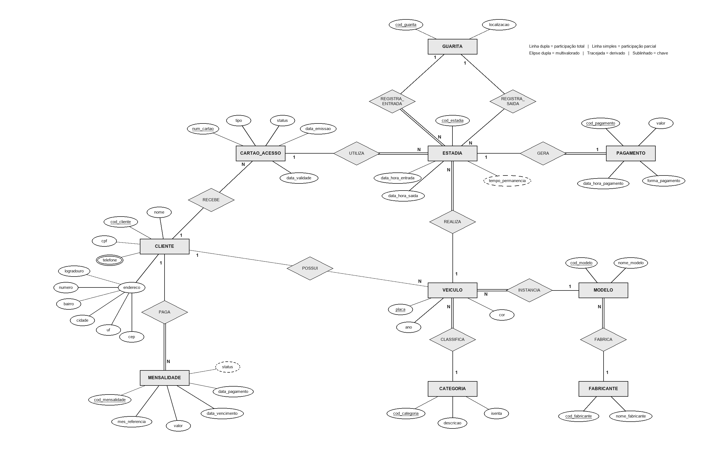
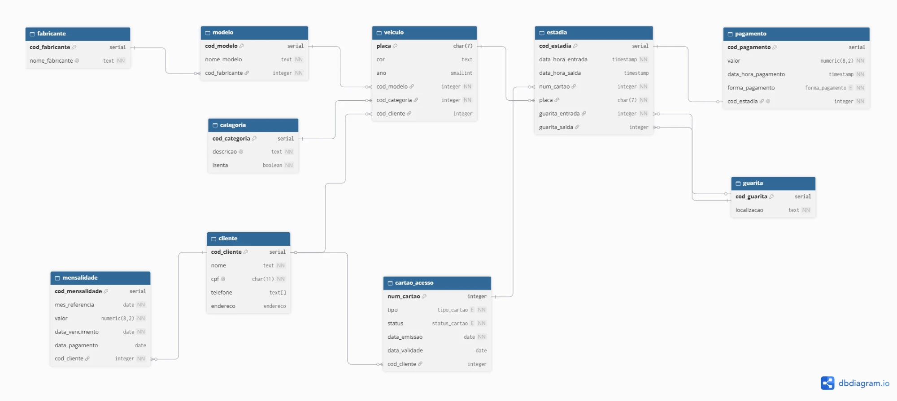

# Sistema de Estacionamento Hospitalar – Projeto de Banco de Dados

Projeto da disciplina **IMD0401 – Banco de Dados – T02 (2026.2)**, Instituto Metrópole Digital (UFRN).
Docente: Gustavo Alves Bezerra · Discente: Fernanda Vitoria Silva Do Nascimento

Banco de dados para o controle de acesso e pagamentos do estacionamento de um hospital, implementado em **PostgreSQL** e executado no **Google Colab**.

## Diagrama Entidade-Relacionamento



Notação de Chen/Elmasri: retângulo = entidade, losango = relacionamento, elipse = atributo.
Linha dupla = participação total · elipse dupla = atributo multivalorado · elipse tracejada = atributo derivado · sublinhado = chave.

## Modelo lógico (tabelas)



Gerado no [dbdiagram.io](https://dbdiagram.io) a partir de [`diagramas/dbdiagram_v2.dbml`](diagramas/dbdiagram_v2.dbml).

## Minimundo

O estacionamento atende dois tipos de uso:

- **Avulso (uso diário):** o visitante retira um cartão na cancela de entrada, paga o tempo de permanência na saída (R$ 5,00 por hora iniciada) e devolve o cartão na máquina, que o reutiliza com o próximo visitante. A pessoa não é cadastrada; ficam registrados o veículo (placa) e a estadia.
- **Mensalista (cliente):** é cadastrado com nome, CPF, telefones e endereço, recebe um cartão pessoal (a máquina devolve o cartão na saída) e paga uma **mensalidade** com vencimento. O status da mensalidade (pago, pendente ou em atraso) é calculado pelas datas.

Todo veículo é cadastrado pela placa, com modelo, fabricante e categoria. Veículos de categoria **isenta** (ambulâncias e veículos médicos) não pagam. Cada entrada gera uma **estadia**, com data e hora e guarita de entrada e de saída. Os cartões têm tipo (mensalista ou avulso) e status (ativo, bloqueado ou perdido).

A descrição completa, com as justificativas da modelagem, está em [`modelagem_v2.md`](modelagem_v2.md).

## Mudanças da iteração 1 para a 2

| Mudança | Por quê |
|---|---|
| Separação entre mensalista e avulso (tipo do cartão) | Deixar claro quem paga como e como o cartão é reutilizado |
| CLIENTE passa a ser só o mensalista | O texto e o diagrama usavam dois nomes (cliente e visitante) para a mesma coisa |
| Veículo ligado à ESTADIA, e não ao cartão | O cartão avulso circula entre vários veículos |
| PAGAMENTO ligado à ESTADIA (1:1) e nova entidade MENSALIDADE | Na v1 não dava para saber qual estadia foi paga, e o mensalista precisa de vencimento |
| STATUS_PAGAMENTO removido; status virou atributo derivado | Pago, pendente ou em atraso pode ser calculado pelas datas |
| Atributo `isenta` em CATEGORIA, sem tarifação diferenciada | Simplificação: veículo hospitalar não paga |
| VAGA removida | Difícil de acompanhar no mundo real |
| Telefone multivalorado e status no cartão | Vários telefones por cliente e controle de cartões perdidos |
| Fabricante com participação parcial em FABRICA | Permitir cadastrar o fabricante antes dos modelos |

## Como executar

1. Abra o notebook [`estacionamento_hospitalar.ipynb`](estacionamento_hospitalar.ipynb) no Google Colab (**Arquivo → Fazer upload de notebook**).
2. Execute tudo em **Ambiente de execução → Executar tudo**. O notebook instala o PostgreSQL, cria o banco, popula as tabelas, testa as restrições e roda as consultas.

Também é possível usar os scripts SQL diretamente num PostgreSQL, nesta ordem:

```bash
createdb estacionamento
psql -d estacionamento -f sql/01_criar_bd.sql
psql -d estacionamento -f sql/02_popular_bd.sql
psql -d estacionamento -f sql/03_consultas.sql
```

## Exemplos de utilização

O notebook (seção 5) traz consultas como:

- veículos no pátio agora;
- tempo de permanência e valor cobrado de cada estadia;
- situação das mensalidades e clientes inadimplentes;
- histórico de um veículo, com guarita de entrada e de saída;
- estadias de veículos isentos;
- faturamento por mês;
- união, interseção e subtração (por exemplo, mensalistas inadimplentes que estão no pátio e veículos que nunca estacionaram).

A seção 4 mostra as restrições do banco recusando dados inválidos (cartão avulso com dono, placa inexistente, segundo pagamento para a mesma estadia etc.).

## Estrutura do repositório

```
├── README.md
├── estacionamento_hospitalar.ipynb   notebook do Colab (criação, população e consultas)
├── modelagem_v2.md                   minimundo, entidades, cardinalidades e justificativas
├── diagramas/
│   ├── der_v2.png                    DER (notação de Chen)
│   ├── der_v2.drawio                 DER editável no draw.io
│   ├── modelo_logico_dbdiagram.png   modelo lógico (tabelas)
│   └── dbdiagram_v2.dbml             código do modelo lógico para o dbdiagram.io
├── sql/
│   ├── 01_criar_bd.sql               tipos, tabelas, restrições e view
│   ├── 02_popular_bd.sql             dados de exemplo
│   ├── 03_consultas.sql              consultas de exemplo
│   └── 04_testes_restricoes.sql      comandos que devem falhar
└── scripts/
    ├── gerar_der.py                  gera o DER (png e drawio)
    └── gerar_notebook.py             gera o notebook e os arquivos .sql
```
